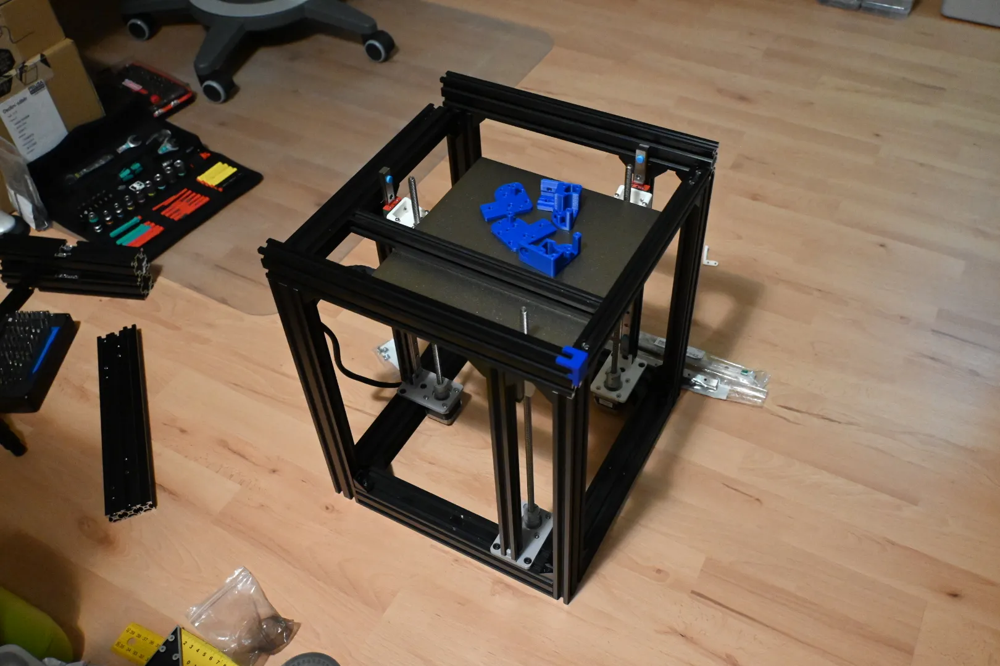
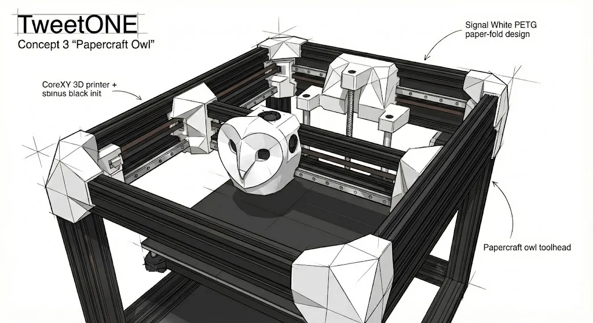
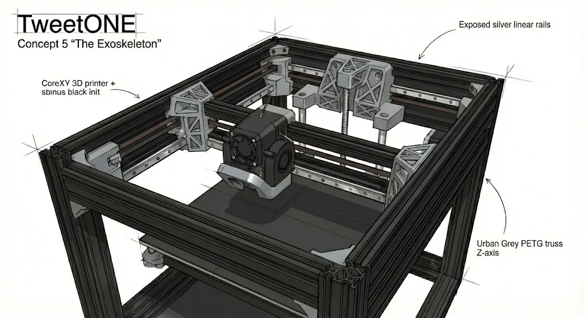
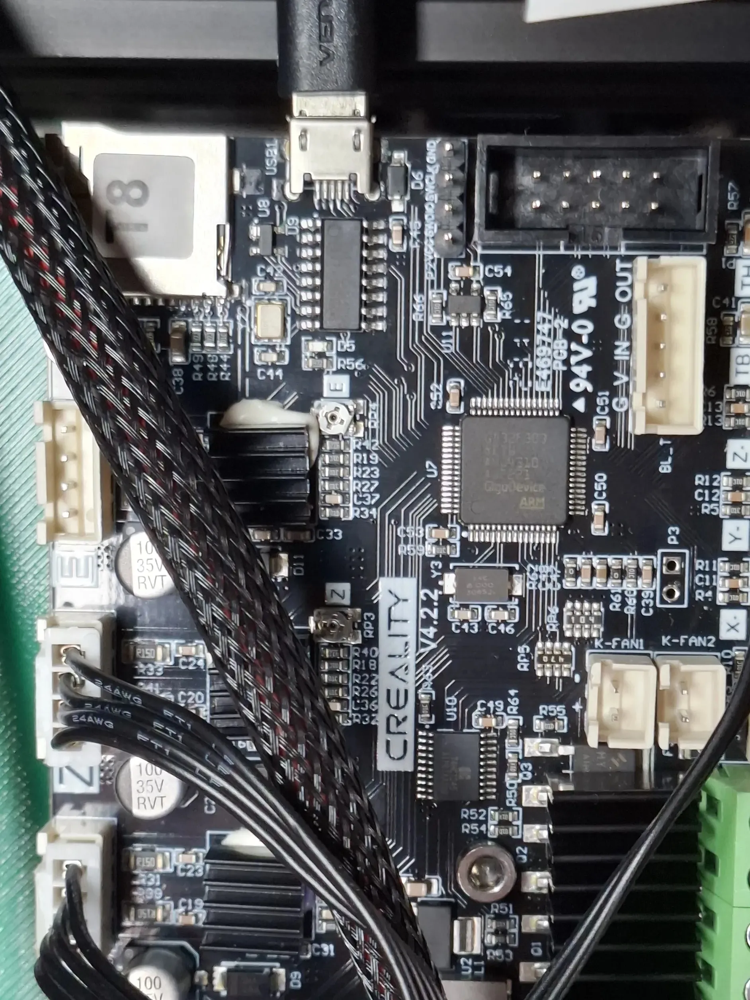
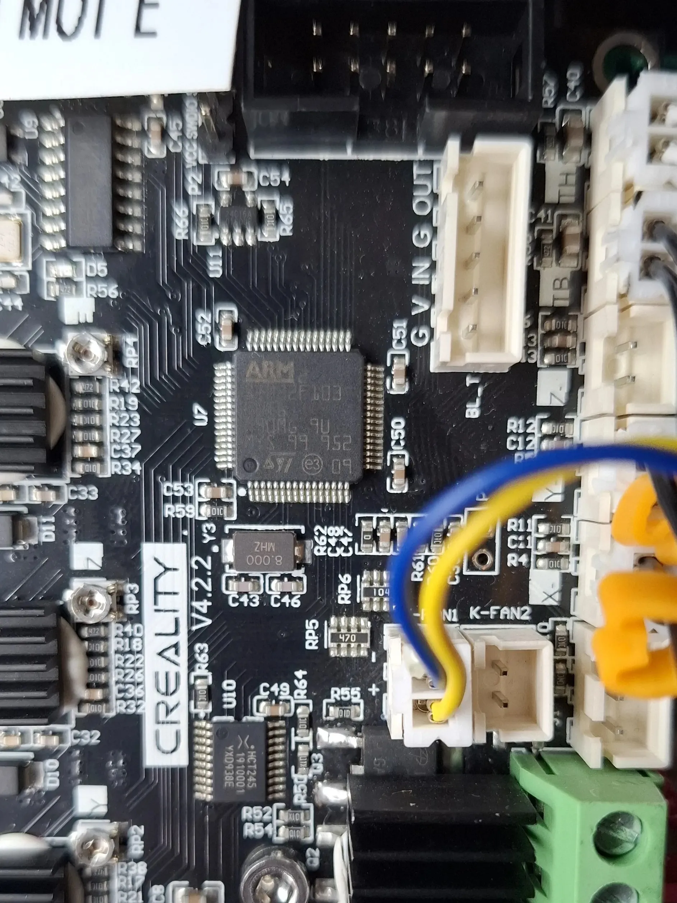

Po silvestrovské objednávce profilů a lineárních kolejnic jsme se v lednu 2026 pustili do samotné stavby mechaniky, optimalizace tiskového prostoru a prvního oživování řídicí elektroniky.



## Optimalizace tiskového prostoru a mechanické detaily

Při skládání rámu se ukázalo několik důležitých detailů, které nám pomohly získat z daných rozměrů maximum tiskové plochy:

* **Otočení zadních profilů:** Zadní svislé profily `2040` jsme otočili o 90°, čímž vznikl potřebný prostor pro zadní motor osy Z. Horní příčku `2040 × 330 mm` jsme přesunuli nad motory XY a zadní sloupek osy Z zkrátili na `330 mm`.
* **Rozdělení napínáků řemenů:** Studovali jsme řešení z projektů *Mercury One.1 (ZeroG)*, *RatRig V-Core 3* a *EVA 3*. Nakonec jsme zvolili rozdělený systém – jedna strana řemenu je uchycena pevně a druhá se napíná samostatným napínákem pro větev X a Y.
* **Údržba lineárního vedení:** Montáž kolejnic dala zabrat – všechny vozíky jsme museli důkladně vyčistit a promazat. U jedné kolejnice od Průši jsme dokonce řešili problém s chodem vozíku se supportem, ale nakonec jsme si poradili sami.





### Hledání vizuální identity: Origami vs. Technický minimalismus

Během zimy jsme ladili i vzhled tiskárny. Zvažovali jsme dva směry:
1. **Origami koncept (Prusament Signal White PETG):** Bílé díly na černém rámu s ostrými liniemi ohybů, tiskovou hlavou stylizovanou do obličeje sovy pálené a držáky podložky ve tvaru papírových vlaštovek.
2. **Technický skeleton (Prusament Urban Grey PETG):** Minimalistické šedé díly, které nechávají naplno vyniknout stříbrné lineární kolejnice, šrouby a otevřenou příhradovou konstrukci Triple-Z.

## Creality loterie: Dvě desky v4.2.2, dva různé procesory

Abychom dokázali ovládat nejen motory X, Y a extruder, ale také **tři nezávislé motory osy Z** (celkem 6 os), potřebovali jsme 6 driverů. Původní deska Creality v4.2.2 má ale pouze 4 drivery. Řešení? Zapojit pod **Raspberry Pi 4B (MainsailOS)** obě původní desky z dárcovských tiskáren najednou v režimu **Multi-MCU**!

Hned při pohledu na čipy nás ale čekala klasická „Creality loterie“:
* **Deska 1 (z Ender 3):** Originální čip **STM32F103**.
* **Deska 2 (z Ender 3 V2):** Čínský klon **GD32F303**.





### Praktické poznatky z flashování a propojení s Raspberry Pi

Zprovoznění obou desek nám dalo cennou školu v ladění Klipperu:

1. **Vybíravý bootloader GD32:** Desky s čipem GD32 vyžadují SD kartu o kapacitě **max. 8 GB** naformátovanou na **FAT32 (alokační jednotka 4096 B)**. Soubor firmwaru se navíc nesmí jmenovat stejně jako při předchozím flashi (pokaždé je nutné použít unikátní název, např. `firmware_v1.bin`).
2. **Nastavení `make menuconfig`:** Pro oba čipy se volí architektura `STM32F103`, `28KiB bootloader`, `8 MHz crystal` a komunikace přes `Serial (on USART1 PA10/PA9)`. U klonu GD32 doporučujeme zaškrtnout i volbu `Disable SWD at startup`.
3. **Izolace 5V pinu na USB kabelech:** Při propojení obou desek s Raspberry Pi přes USB docházelo ke zpětnému napájení desek z RPi a nestabilitě. Pomohlo přelepení 5V pinu v USB konektorech kaptonovou páskou.
4. **Prohozené piny a logika enable pinu:** Při prvním testování motorů na deskách Creality v4.2.2 jsme narazili na to, že piny `step_pin` a `dir_pin` pro osy Y a Z byly v šabloně prohozené a společný `enable_pin: !PC3` vyžadoval negaci vykřičníkem, aby drivery HR4988 správně spínaly.

```ini
# Ukázka rozdělení motorů mezi hlavní MCU (STM32) a sekundární MCU GD (Triple-Z)
[mcu]
serial: /dev/serial/by-path/platform-fd500000.pcie-pci-0000:01:00.0-usb-0:1.2:1.0-port0

[mcu GD]
serial: /dev/serial/by-path/platform-fd500000.pcie-pci-0000:01:00.0-usb-0:1.1:1.0-port0

[stepper_z]
step_pin: !GD:PB8
dir_pin: GD:PB9
enable_pin: !GD:PC3
microsteps: 16
rotation_distance: 8
```
[← Předchozí](/cs/blog/tweetone-chapter1/ "1. Jak ze dvou bazarových Enderů postavit CoreXY tiskárnu") · [Přehled](/cs/blog/tweetone-corexy-build-notes/ "TweetONE CoreXY: od dvou Enderů 3 k rychlé tiskárně CoreXY") · [1](/cs/blog/tweetone-chapter1/ "1. Jak ze dvou bazarových Enderů postavit CoreXY tiskárnu") · **[2]** · [3](/cs/blog/tweetone-chapter3/ "3. První tisk, přesnost Z-Tilt 0,005 mm a přechod na DragonBurner") · [4](/cs/blog/tweetone-chapter4/ "4. Přechod na BTT Manta M8P v2.0, CB1 a CANbus toolboard EBB36") · [5](/cs/blog/tweetone-chapter5/ "5. Kalibrace Input Shaperu (14 400 mm/s²) a teplotní drift BTT Eddy Duo") · [6](/cs/blog/tweetone-chapter6/ "6. Tiskárna jako budoucí maturitní práce – plán měření anti-backlash matic a napětí řemenů") · [Další →](/cs/blog/tweetone-chapter3/ "3. První tisk, přesnost Z-Tilt 0,005 mm a přechod na DragonBurner")
---