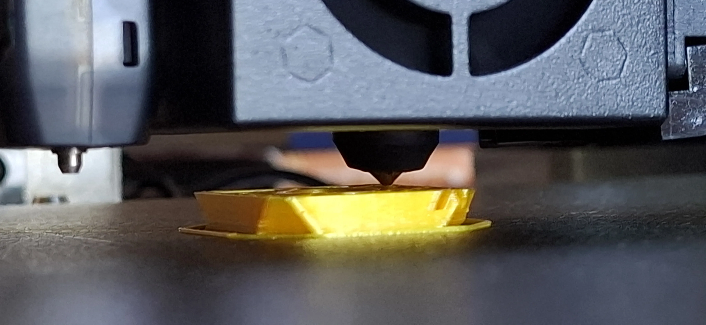

V srpnu 2026 se projekt přehoupl z fáze „drátů na stole“ do fáze skutečného tiskového stroje. Abychom tiskárnu co nejrychleji zprovoznili, nasadili jsme pro první testy původní tiskovou hlavu z Enderu 3.

## Od problémů se Z-endstopem k přesnému Z-Tiltu

Původně jsme zkoušeli na osu Z nasadit indukční/vířivou sondu **BTT Eddy Duo**, ale kvůli potížím s homováním osy Z jsme ji pro první tiskové testy dočasně odložili a nakonfigurovali osvědčený **CR-Touch** jako virtuální endstop.

Po ověření směru pohybu (`STEPPER_BUZZ`) a základní kalibraci výšky trysky (`PROBE_CALIBRATE`) přišel na řadu hlavní důvod, proč jsme stavěli tříbodovou osu Z: **automatické srovnání rovinnosti podložky (`Z_TILT_ADJUST`)**.

První pokusy nevyšly, protože motory nebyly správně přiřazené ke svým rohům podložky. Pomohlo jednoduché pravidlo:
1. Odkrokovat si v rozhraní Mainsailu souřadnice všech tří kotevních bodů podložky **proti směru hodinových ručiček** (`Z` = přední levý roh → `Z1` = zadní střed → `Z2` = přední pravý roh).
2. Ověřit fyzické zapojení každého motoru k příslušnému driveru.

Výsledek stál za to: po spuštění `Z_TILT_ADJUST` se podložka srovnala s odchylkou **0,005 mm** a následná kalibrace sítě podložky (`BED_MESH_CALIBRATE` 5×5 bodů) zajistila perfektní první vrstvu.

> **Bezpečnostní vsuvka z praxe:** Při úpravách uchycení 24V zdrojů a kabeláže jsme si znovu připomněli zlaté pravidlo *Safety First* – než sáhnete do elektroniky, vždy tiskárnu fyzicky odpojte ze zásuvky 230 V.

## Proč původní hotend nestačí a co dál?

Hned při prvních tiscích se projevila slabina starého hotendu z Enderu 3 – při vyšších rychlostech CoreXY se opakovaně ucpávala tryska. Bylo jasné, že původní hlava splnila svou roli jako testovací mula, ale pro ostrý provoz potřebujeme lehký, moderní direct-drive toolhead.

Volba padla na komunitní hlavu **Voron DragonBurner** v kombinaci s extruderem **LGX Lite** a návratem sondy **BTT Eddy Duo**. Současně jsme začali zkoumat i možnosti budoucího rozšíření o **toolchanger** (porovnávali jsme konstrukce *Prusa XL*, *Daksh*, *MadMax*, *Lineux* i kinematické uložení pomocí kuliček a magnetů), protože pevný rám CoreXY nám k tomu do budoucna otevírá dveře.
---
[← Předchozí](/cs/blog/tweetone-chapter2/ "2. Stavba mechaniky, design a oživení dvou desek Creality v Klipperu") · [Přehled](/cs/blog/tweetone-corexy-build-notes/ "TweetONE CoreXY: od dvou Enderů 3 k rychlé tiskárně CoreXY") · [1](/cs/blog/tweetone-chapter1/ "1. Jak ze dvou bazarových Enderů postavit CoreXY tiskárnu") · [2](/cs/blog/tweetone-chapter2/ "2. Stavba mechaniky, design a oživení dvou desek Creality v Klipperu") · **[3]** · [4](/cs/blog/tweetone-chapter4/ "4. Přechod na BTT Manta M8P v2.0, CB1 a CANbus toolboard EBB36") · [5](/cs/blog/tweetone-chapter5/ "5. Kalibrace Input Shaperu (14 400 mm/s²) a teplotní drift BTT Eddy Duo") · [6](/cs/blog/tweetone-chapter6/ "6. Tiskárna jako budoucí maturitní práce – plán měření anti-backlash matic a napětí řemenů") · [Další →](/cs/blog/tweetone-chapter4/ "4. Přechod na BTT Manta M8P v2.0, CB1 a CANbus toolboard EBB36")
---