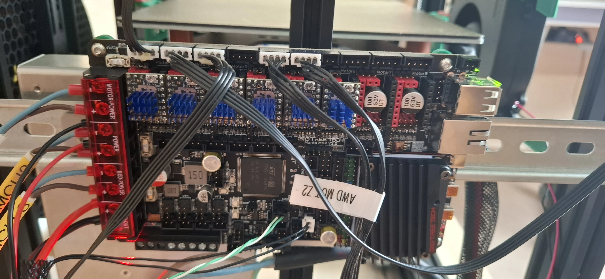
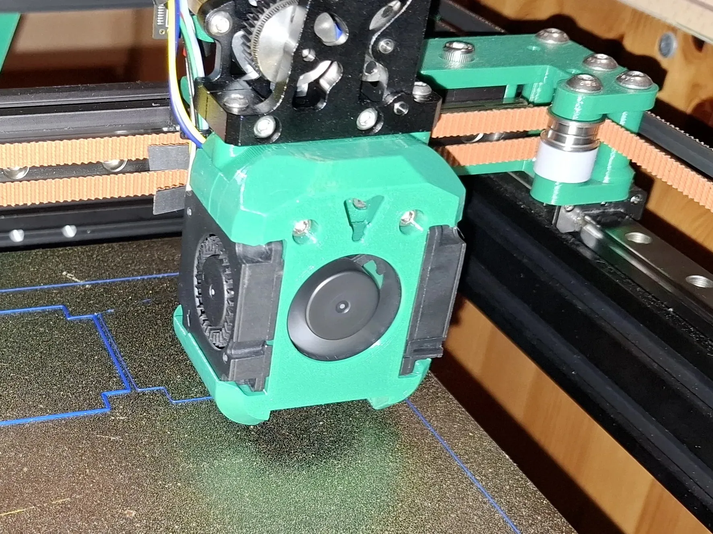

Provoz dvou desek Creality v4.2.2 pod Raspberry Pi 4B splnil svůj účel, ale pro čistou kabeláž, tiché drivery TMC2209 s podporou *Sensorless Homing* a budoucí rozšiřitelnost (toolchanger) jsme na konci srpna přešli na profesionální řešení: desku **BIGTREETECH Manta M8P v2.0** osazenou výpočetním modulem **BTT CB1** a CANbus deskou **BTT EBB36** přímo na tiskové hlavě DragonBurner.



## 1. Instalace systému na modul BTT CB1 (Důležitá past v Imageru!)

Při přípravě obrazu OS (Debian s předinstalovaným Klipperem a Moonrakerem z GitHubu BTT) jsme narazili na zásadní rozdíl oproti klasickému Raspberry Pi: **v programu Raspberry Pi Imager nesmíte použít nastavení OS Customization (Wi-Fi a SSH)**. Modul CB1 tyto údaje ignoruje.

Správný postup:
1. Zapsat čistý `.img.xz` obraz na MicroSD kartu.
2. Otevřít oddíl `BOOT` v editoru, který zachovává Unix konce řádků (VS Code nebo Notepad++).
3. V souboru `system.cfg` odkomentovat a vyplnit údaje přímo:

```ini
WIFI_SSID="Vase_Nazev_WiFi"
WIFI_PASSWD="Vase_Heslo_Na_WiFi"
hostname="TweetONE-M"
```

2. Oživení CANbus desky BTT EBB36 přes CanBoot
Abychom nemuseli k tiskové hlavě tahat svazek deseti vodičů, osadili jsme na DragonBurner desku BTT EBB36. Její oživení proběhlo přes USB z modulu CB1:

Podržet tlačítko BOOT na EBB36 a připojit USB kabel (deska se přepne do DFU režimu, což potvrdí lsusb).

Naklonovat repozitář Arksine/CanBoot, nakonfigurovat přes make menuconfig a nahrát bootloader.

Následně zkompilovat a nahrát samotný Klipper firmware pro EBB36.




3. Mapování motorů a Sensorless Homing na Manta M8P v2.0
Deska Manta M8P v2.0 nabízí 8 pozic pro drivery, což nám umožnilo přehledně zapojit všech 6 aktivních motorů a nechat si 2 sloty v rezervě:

Motor 1: Levý motor XY (stepper_x, diag_pin: ^PF4)

Motor 2: Pravý motor XY (stepper_y, diag_pin: ^PF3)

Motor 3: Extruder

Motor 6: Levý přední motor Z (stepper_z)

Motor 7: Zadní motor Z (stepper_z1)

Motor 8: Pravý přední motor Z (stepper_z2)

Pro osy X a Y jsme aktivovali Sensorless Homing přes drivery TMC2209 (bez mechanických koncových spínačů). U Klipperu je přitom nutné dodržet homing_retract_dist: 0 a doladit citlivost driver_SGTHRS (začínali jsme na hodnotě 100), aby hlava spolehlivě zastavila bez narážení do rámu.

```
[stepper_x]
step_pin: PE6
dir_pin: PE5
enable_pin: !PC14
microsteps: 16
rotation_distance: 40
endstop_pin: tmc2209_stepper_x:virtual_endstop
position_endstop: 0
position_max: 235
homing_speed: 40
homing_retract_dist: 0

[tmc2209 stepper_x]
uart_pin: PC13
diag_pin: ^PF4
run_current: 0.800
driver_SGTHRS: 100
```

Drobné zádrhely a jak jsme je vyřešili
Mechanická kolize vozíku: Při testování plného rozsahu pohybu se vozík zasekával o plastový držák rámu. Stačilo díl v CADu o pár milimetrů zkrátit a znovu vytisknout.

Spínání ventilátoru přes MOSFET: Pro spolehlivé řízení chlazení (FAN0) jsme do okruhu zařadili externí spínací modul s tranzistorem IRF520.
---
[← Předchozí](/cs/blog/tweetone-chapter3/ "3. První tisk, přesnost Z-Tilt 0,005 mm a přechod na DragonBurner") · [Přehled](/cs/blog/tweetone-corexy-build-notes/ "TweetONE CoreXY: od dvou Enderů 3 k rychlé tiskárně CoreXY") · [1](/cs/blog/tweetone-chapter1/ "1. Jak ze dvou bazarových Enderů postavit CoreXY tiskárnu") · [2](/cs/blog/tweetone-chapter2/ "2. Stavba mechaniky, design a oživení dvou desek Creality v Klipperu") · [3](/cs/blog/tweetone-chapter3/ "3. První tisk, přesnost Z-Tilt 0,005 mm a přechod na DragonBurner") · **[4]** · [5](/cs/blog/tweetone-chapter5/ "5. Kalibrace Input Shaperu (14 400 mm/s²) a teplotní drift BTT Eddy Duo") · [6](/cs/blog/tweetone-chapter6/ "6. Tiskárna jako budoucí maturitní práce – plán měření anti-backlash matic a napětí řemenů") · [Další →](/cs/blog/tweetone-chapter5/ "5. Kalibrace Input Shaperu (14 400 mm/s²) a teplotní drift BTT Eddy Duo")
---
