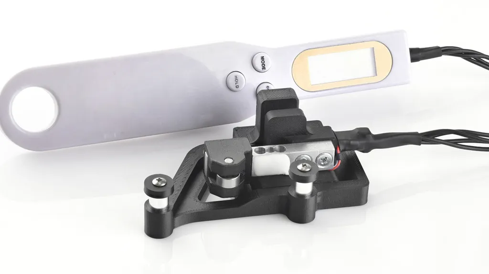

Stavba 3D tiskárny **TweetONE** od začátku nemá být jen víkendovým kutilským projektem. Za dva roky syna čeká maturita a právě tato tiskárna se stane praktickým základem pro jeho **maturitní práci**, ve které propojí mechaniku, elektroniku a měření přesnosti pohybových soustav.

Nad rámec samotné stavby a zprovoznění celého projektu (vycházejícího z komunitní přestavby [Duender CoreXY](https://www.printables.com/model/1282344-duender-mgn12h-edition)) jsme v našem vývojovém deníku vytipovali dvě klíčové oblasti, které u CoreXY tiskáren postavených ze starších komponent rozhodují o kvalitě tisku a na které se v rámci maturitní práce zaměříme.

## 1. Vliv anti-backlash POM matic na přesnost osy Z

U cenově dostupných tiskáren (jako Ender 3) bývají trapézové tyče často mírně prohnuté a standardní mosazné matice mají mezi závity drobnou vůli (*backlash*). Při změně směru pohybu nebo mikroskopických korekcích během `Z_TILT_ADJUST` a `BED_MESH` pak vzniká nepřesnost a viditelné vlnkování stěn (*Z-wobble*).

V budoucí maturitní práci proto syn porovná klasické mosazné matice s dvoudílnými odpruženými **anti-backlash maticemi z POM (Delrinu)** (inspirováno [analýzou přesnosti anti-backlash matic na ose Z](https://www.youtube.com/watch?v=kmqLz-AmzVw) a instalací na [sérii Ender 3](https://www.youtube.com/watch?v=Lpc1bTsSpRA)):
* **Vymezení mrtvého chodu:** Pružina bude neustále tlačit obě poloviny matice proti bokům závitu trapézové tyče, čímž eliminuje axiální vůli.
* **Tlumení vibrací a tišší chod:** POM je technický plast s nízkým součinitelem tření a vysokou odolností proti opotřebení. V kombinaci s pružnými spojkami motorů umožní mírně křivé tyči „plavat“, aniž by se její házivost přenášela do lineárního vedení podložky (podobně jako u konstrukčních řešení [Ender 3 NG pro eliminaci Z-wobble](https://www.youtube.com/watch?v=1dhn0S28OuU)).
* **Plánovaná metodika měření:** Pomocí opakovaného najíždění osy Z a vyhodnocení opakovatelnosti měření sondou (a úchylkoměrem) kvantifikujeme rozdíl v přesnosti polohování obou typů matic a vyhodnotíme jeho vliv na povrch výtisků.

## 2. DIY tenzometrický měřič napětí řemenů GT2

U kinematiky [CoreXY](https://3ddistributed.com/corexy-3d-printer/corexy-belt-routing/) platí jedno neúprosné pravidlo: **oba řemeny (A i B) musí mít identické napětí**. Pokud je jeden řemen napnutý více než druhý, příčný nosník osy X se mírně zkříží, tiskárna netiskne pravé úhly a zhoršuje se i rezonanční charakteristika při vyšších akceleracích.

Místo odhadu „podle zvuku drnknutí“ nebo drahých komerčních tenzometrů se v rámci rozšiřující části projektu pustíme do stavby vlastního měřiče napětí řemenů **GT2 (6 mm)** s tenzometrickým snímačem podle návodu [GT2 Belt Tension Meter with strain gauge sensor](https://www.youtube.com/watch?v=vsF08ZM7MTI):

### Plánovaný kusovník tenzometrického měřiče
* **Snímač a elektronika:** Tenzometr a displej vykuchaný z [digitální kuchyňské lžicové váhy](https://www.aliexpress.com/item/1005011682429430.html) (rozsah 500 g, rozlišení 0,1 g).
* **Tělo měřiče:** 3D tištěné díly (tělo, páka, držák).
* **Mechanické prvky:**
  * 1× kuličkové ložisko `3 × 8 × 4 mm`
  * 1× čep `13,5 × 3 mm` a 1× hřídel `2 × 43 mm`
  * 1× tlačná pružina (průměr drátu `0,5 mm`, vnější průměr `5 mm`, délka `27 mm`)
  * 2× kovová vložka `5,1 × 6,8 × 10,5 mm`
  * Šrouby: 2× `M3 × 5,5 mm` a 2× `M3 × 10 mm` se zapuštěnou hlavou

[FOTO: Vizualizace zapojení 3D tištěného měřiče napětí řemenů GT2 při měření na tiskárně]

Díky vlastnímu měřiči pak dokážeme napětí obou větví CoreXY řemenů nastavit na stejnou číselnou hodnotu. Syn následně v maturitní práci objektivně zmapuje a zdokumentuje, jak se přesná změna předpětí řemenů projeví na rezonančních křivkách **Input Shaperu** i na rozměrové přesnosti finálních výtisků.

## Zdroje a reference z vývojového deníku
* [Will this Z axis anti backlash nut improve your 3D printer accuracy? (YouTube)](https://www.youtube.com/watch?v=kmqLz-AmzVw)
* [Stop the Drop! Install an Anti-Backlash Nut on Ender-3 Series (YouTube)](https://www.youtube.com/watch?v=Lpc1bTsSpRA)
* [GT2 Belt Tension Meter with strain gauge sensor (YouTube)](https://www.youtube.com/watch?v=vsF08ZM7MTI)
* [CoreXY Belt Routing – principy a napínání řemenů (3D Distributed)](https://3ddistributed.com/corexy-3d-printer/corexy-belt-routing/)