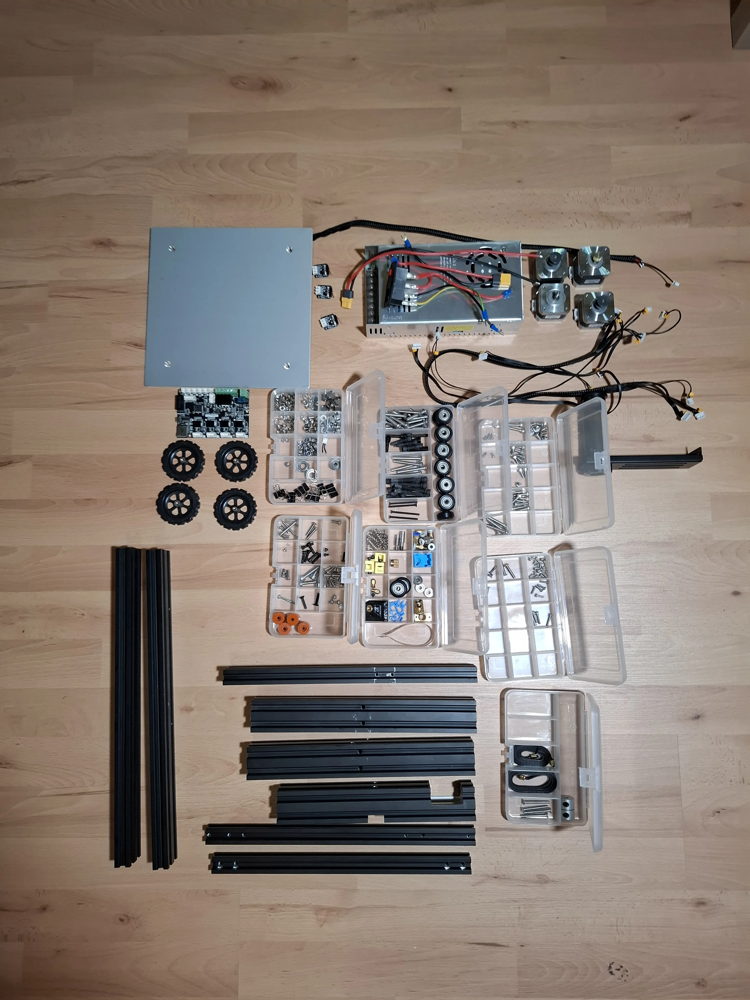
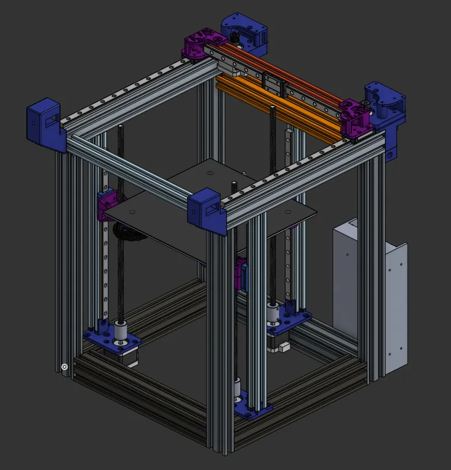

In December 2025, we started our biggest joint hardware project: building **TweetONE**, a high-speed CoreXY 3D printer, from two second-hand machines, a **Creality Ender 3** and an **Ender 3 V2**. Our son had already made many modifications to the original Ender 3 Pro, so moving to CoreXY kinematics was a natural next step.

We chose the open community project **Duender CoreXY** (and the related **Ender 3 NG**) as our starting point. Duender is designed to reuse as many aluminum profiles, motors, and fasteners from the donor printers as possible.

## A key difference between the Ender 3 and Ender 3 V2: Y-axis profiles

The original Duender design is based on early Ender 3 models, which used `2040` profiles beneath the heated bed on the Y axis. The newer **Ender 3 V2** uses a wider `4040` Y-axis profile. Unless you redesign the carriages, making them larger and heavier, you need two `2040` profiles for the Y axis.

After dismantling both printers and ordering additional profiles on December 31, 2025, we arrived at the following frame inventory:

| Profile size | Quantity | Source | Use in TweetONE |
| :--- | :---: | :--- | :--- |
| **4040 – 290 mm** | 4× | Base legs from E3 + E3 V2 | Lower rectangular frame |
| **4040 – 330 mm** | 1× | Y axis (Ender 3 V2) | Spare (unused) |
| **2040 – 400 mm** | 4× | Uprights from E3 + E3 V2 | Main vertical frame members |
| **2040 – 330 mm** | 1× | Y axis (Ender 3) | Spare (replaced by longer profiles) |
| **2040 – 350 mm** | 2× | Purchased (V-Slot Black) | Mounting the Y-axis linear rails |
| **2020 – 330 mm** | 2× | Original top cross members from E3 + E3 V2 | 1× rear X/Z motor support, 1× spare |
| **2020 – 345 mm** | 2× | Original X axes (E3 + E3 V2) | Spare |
| **2020 – 300 mm** | 1× | Cut down from 330 mm | X-axis gantry cross member |
| **2020 – 350 mm** | 4× | Purchased (V-Slot Black) | 3× uprights for Triple-Z linear rails, 1× spare |

### What else did we reuse, and what did we buy?

* **Stepper motors:** We reused all the original motors. The strongest motors, from the two extruders, drive X and Y; the remaining motors drive Z. *(On the newer Ender 3 V2, the brass pulleys are heat-pressed onto the shafts, so a dedicated puller is useful for removing them.)*
* **Lead screws:** The original Z-axis screws were reused. With a conventional installation, they need to be shortened by 10–15 mm to prevent the extruder from hitting them.
* **Heated bed and power supply:** The original heated bed and 24 V power supply remain in use.
* **Additional hardware (about CZK 1,000–1,200 excluding rails):** 20 **F623RS** flanged bearings, two **2GT belts (6 mm wide, about 1.5 m long)**, approximately **40 metal corner brackets** with M5×8 mm screws and T-nuts, and M3 heat-set inserts. The metal brackets are essential for keeping the frame square.

## Moving beyond V-wheels: linear rails and Triple-Z

The basic Duender uses the original V-wheels, but we chose linear motion from the outset for greater speed and accuracy, drawing inspiration from **Duender MGN9H / MGN12H** and **Ender 3 NG / VIRTU E3**:

1. **X axis – Japanese THK SRS 12GN (310 mm):** The biggest challenge was fitting a Prusa linear rail to the X gantry. The THK rail provides high precision without play, an advantage on the fast-moving toolhead axis. To achieve the correct carriage spacing (304.7 mm), we cut the X-axis profile to exactly **300 mm**.
2. **Y and Z axes – MGN rails and three independent Z motors:** For Y, we selected rails mounted on `2040 × 350 mm` profiles. For Z, we chose an independently driven three-point bed support (**Triple-Z**) with more affordable rails from *Magic Dragon* and [alignment clips for 2020 profiles](https://www.printables.com/model/703504-2020-linear-rail-alignment-clips).
3. **Anti-backlash POM nuts:** We fitted spring-loaded POM (Delrin) nuts to the lead screws to take up thread play and reduce the transfer of screw irregularities (*Z-wobble*). A comparison with conventional brass nuts will also provide material for our son's graduation project.

## Print the parts before dismantling

All plastic frame parts and brackets had to be printed before we dismantled the last working printer. We chose **ABS / ASA** for moving parts and components near the motors because of their heat resistance and rigidity, and **PETG** for external stationary parts. We used 4–5 perimeters, 5–7 top and bottom layers, and at least **50%** infill, increasing it to 100% for heavily loaded brackets.

---

[Overview](/blog/tweetone-corexy-build-notes/ "TweetONE CoreXY: from two Ender 3s to a high-speed CoreXY build") · **[1]** · [2](/blog/tweetone-chapter2/ "2. Building the frame, choosing a design, and bringing two Creality boards up in Klipper") · [3](/blog/tweetone-chapter3/ "3. First print, 0.005 mm Z-Tilt accuracy, and the move to DragonBurner") · [4](/blog/tweetone-chapter4/ "4. Switching to the BTT Manta M8P v2.0, CB1, and EBB36 CANbus toolboard") · [5](/blog/tweetone-chapter5/ "5. Input Shaper tuning (14,400 mm/s²) and BTT Eddy Duo thermal drift") · [6](/blog/tweetone-chapter6/ "6. A future graduation project: measuring anti-backlash nuts and belt tension") · [Next →](/blog/tweetone-chapter2/ "2. Building the frame, choosing a design, and bringing two Creality boards up in Klipper")
