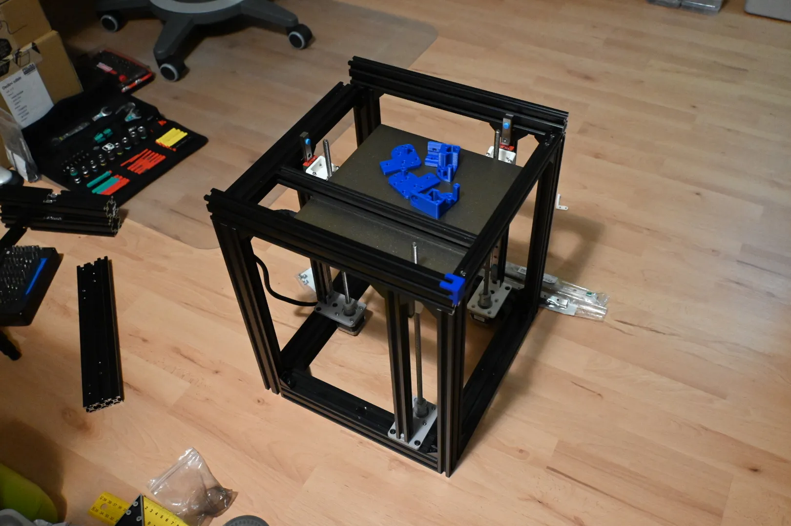
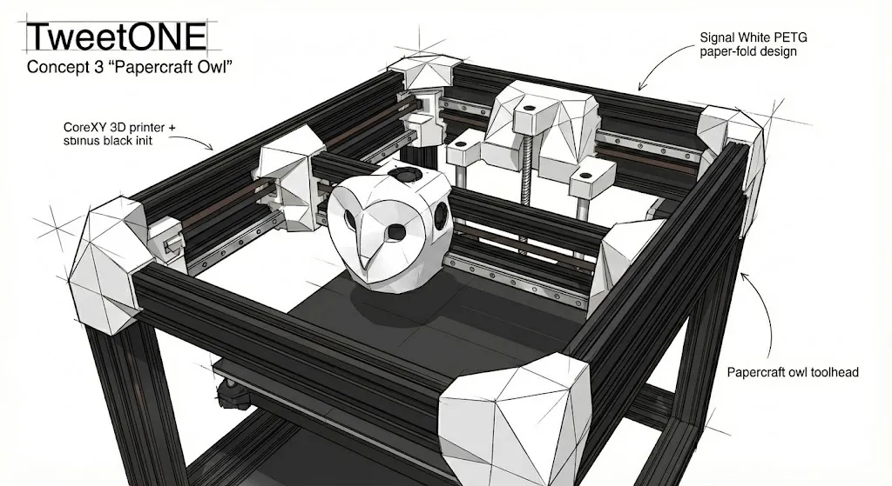
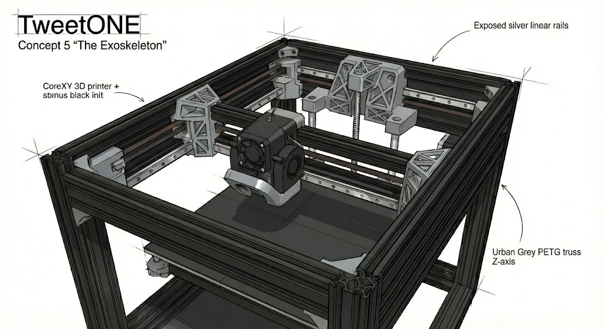
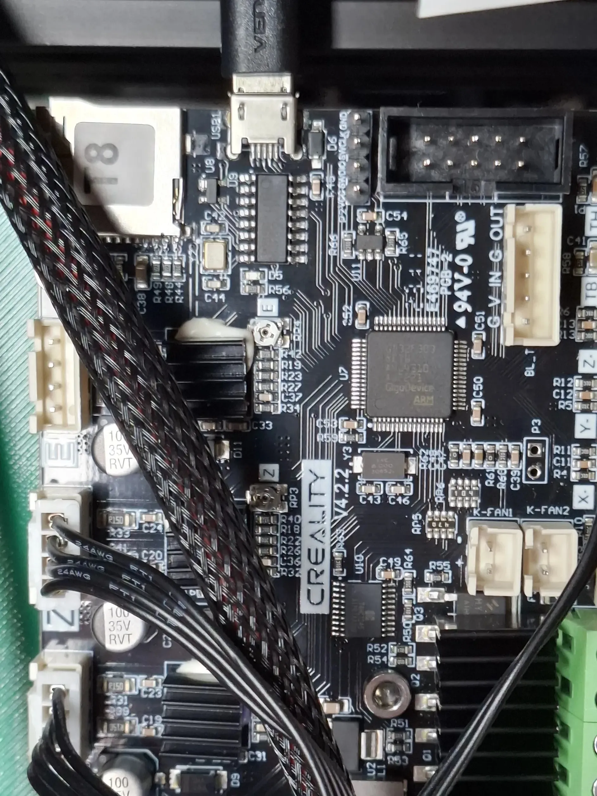
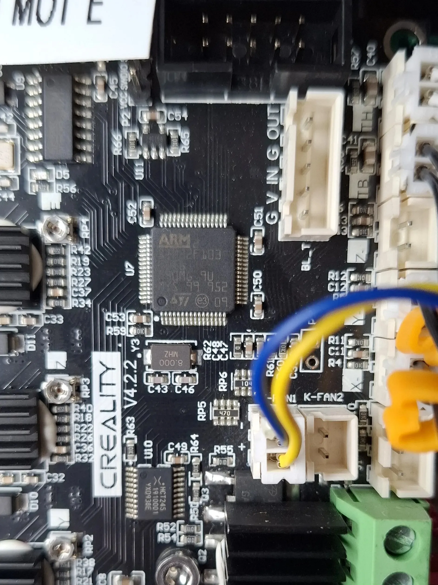

After ordering the profiles and linear rails on New Year's Eve, we began assembling the mechanics, optimizing the build volume, and bringing up the control electronics in January 2026.



## Optimizing the build volume and mechanical details

Several details emerged during frame assembly that helped us make the most of the available dimensions:

* **Rotating the rear profiles:** We rotated the rear `2040` uprights by 90° to make room for the rear Z motor. We moved the upper `2040 × 330 mm` cross member above the XY motors and shortened the rear Z upright to `330 mm`.
* **Separate belt tensioners:** We studied solutions from *Mercury One.1 (ZeroG)*, *RatRig V-Core 3*, and *EVA 3*. We settled on a split system: one end of each belt is fixed, while the other is adjusted with a separate tensioner for the X and Y branches.
* **Linear rail maintenance:** Installing the rails took work: every carriage needed thorough cleaning and lubrication. We also dealt with a carriage travel issue on one of the Prusa rails and eventually resolved it ourselves.




### Finding a visual identity: Origami vs. technical minimalism

Over the winter, we explored two visual directions:

1. **Origami concept (Prusament Signal White PETG):** White parts on a black frame, with sharp folded lines, a toolhead styled like a barn owl's face, and bed mounts shaped like paper swallows.
2. **Technical skeleton (Prusament Urban Grey PETG):** Minimalist gray parts that let the silver linear rails, screws, and open Triple-Z truss structure stand out.

## The Creality lottery: two v4.2.2 boards, two different processors

To control X, Y, and the extruder as well as **three independent Z motors**, we needed six drivers. A Creality v4.2.2 board has only four. Our solution was to connect both original donor boards to a **Raspberry Pi 4B running MainsailOS** in a **multi-MCU** configuration.

The chips presented the familiar Creality lottery:

* **Board 1 (from the Ender 3):** An original **STM32F103**.
* **Board 2 (from the Ender 3 V2):** A Chinese **GD32F303** clone.





### Flashing and connecting the boards to the Raspberry Pi

Bringing up both boards taught us several useful Klipper lessons:

1. **Picky GD32 bootloader:** GD32 boards require an SD card of **8 GB or less**, formatted as **FAT32 with a 4096-byte allocation unit**. The firmware filename must also differ from the previous flash; use a unique name each time, such as `firmware_v1.bin`.
2. **`make menuconfig` settings:** For both chips, select `STM32F103`, `28KiB bootloader`, `8 MHz crystal`, and `Serial (on USART1 PA10/PA9)` communication. For the GD32 clone, we also recommend `Disable SWD at startup`.
3. **Isolating the USB 5 V pin:** Connecting both boards to the Raspberry Pi over USB caused backfeeding and instability. Covering the 5 V pin in the USB connectors with Kapton tape helped.
4. **Swapped pins and enable logic:** During initial motor tests on the Creality v4.2.2 boards, we found the Y and Z `step_pin` and `dir_pin` values swapped in the template. The shared `enable_pin: !PC3` also needed the exclamation-mark inversion for the HR4988 drivers to switch correctly.

```ini
# Example motor allocation between the primary MCU (STM32) and secondary MCU GD (Triple-Z)
[mcu]
serial: /dev/serial/by-path/platform-fd500000.pcie-pci-0000:01:00.0-usb-0:1.2:1.0-port0

[mcu GD]
serial: /dev/serial/by-path/platform-fd500000.pcie-pci-0000:01:00.0-usb-0:1.1:1.0-port0

[stepper_z]
step_pin: !GD:PB8
dir_pin: GD:PB9
enable_pin: !GD:PC3
microsteps: 16
rotation_distance: 8
```

---

[← Previous](/blog/tweetone-chapter1/ "1. Building a CoreXY printer from two second-hand Ender 3s") · [Overview](/blog/tweetone-corexy-build-notes/ "TweetONE CoreXY: from two Ender 3s to a high-speed CoreXY build") · [1](/blog/tweetone-chapter1/ "1. Building a CoreXY printer from two second-hand Ender 3s") · **[2]** · [3](/blog/tweetone-chapter3/ "3. First print, 0.005 mm Z-Tilt accuracy, and the move to DragonBurner") · [4](/blog/tweetone-chapter4/ "4. Switching to the BTT Manta M8P v2.0, CB1, and EBB36 CANbus toolboard") · [5](/blog/tweetone-chapter5/ "5. Input Shaper tuning (14,400 mm/s²) and BTT Eddy Duo thermal drift") · [6](/blog/tweetone-chapter6/ "6. A future graduation project: measuring anti-backlash nuts and belt tension") · [Next →](/blog/tweetone-chapter3/ "3. First print, 0.005 mm Z-Tilt accuracy, and the move to DragonBurner")
