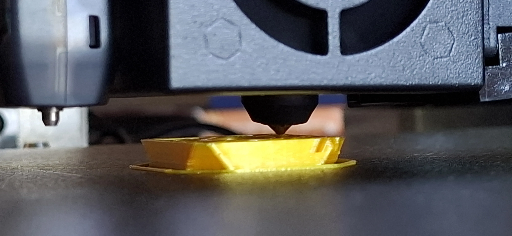

In August 2026, the project moved from a collection of wires on the table to a working printer. To get it running as quickly as possible, we used the original Ender 3 toolhead for the first tests.

## From Z-endstop problems to accurate Z-tilt adjustment

We initially tried a **BTT Eddy Duo** inductive/eddy current probe on the Z axis. Because of Z homing difficulties, we temporarily set it aside for the first print tests and configured a proven **CR-Touch** as a virtual endstop instead.

After checking motor direction with `STEPPER_BUZZ` and calibrating the nozzle height with `PROBE_CALIBRATE`, we moved on to the main reason for building a three-point Z axis: **automatic bed alignment with `Z_TILT_ADJUST`**.

The first attempts failed because the motors were not assigned to the correct bed corners. A simple procedure helped:

1. Use Mainsail to determine the coordinates of the three bed support points in **counterclockwise order** (`Z` = front left → `Z1` = rear center → `Z2` = front right).
2. Check that each motor is physically connected to its corresponding driver.

The result was worth it: `Z_TILT_ADJUST` aligned the bed to a deviation of **0.005 mm**, and the subsequent 5×5-point bed mesh calibration (`BED_MESH_CALIBRATE`) delivered an excellent first layer.

> **A practical safety reminder:** When modifying the 24 V power supplies and wiring, we were reminded of the golden rule: physically disconnect the printer from the 230 V mains before working on its electronics.

## Why the original hotend was not enough

The first prints revealed a weakness in the old Ender 3 hotend: at higher CoreXY speeds, the nozzle repeatedly clogged. The original head had done its job as a test mule, but regular operation called for a light, modern direct-drive toolhead.

We chose the community-designed **Voron DragonBurner**, paired with an **LGX Lite** extruder and a return to the **BTT Eddy Duo** probe. We also began exploring a future **toolchanger**, comparing *Prusa XL*, *Daksh*, *MadMax*, and *Lineux* designs as well as kinematic mounts using balls and magnets. The rigid CoreXY frame leaves room for that kind of expansion.

---

[← Previous](/blog/tweetone-chapter2/ "2. Building the frame, choosing a design, and bringing two Creality boards up in Klipper") · [Overview](/blog/tweetone-corexy-build-notes/ "TweetONE CoreXY: from two Ender 3s to a high-speed CoreXY build") · [1](/blog/tweetone-chapter1/ "1. Building a CoreXY printer from two second-hand Ender 3s") · [2](/blog/tweetone-chapter2/ "2. Building the frame, choosing a design, and bringing two Creality boards up in Klipper") · **[3]** · [4](/blog/tweetone-chapter4/ "4. Switching to the BTT Manta M8P v2.0, CB1, and EBB36 CANbus toolboard") · [5](/blog/tweetone-chapter5/ "5. Input Shaper tuning (14,400 mm/s²) and BTT Eddy Duo thermal drift") · [6](/blog/tweetone-chapter6/ "6. A future graduation project: measuring anti-backlash nuts and belt tension") · [Next →](/blog/tweetone-chapter4/ "4. Switching to the BTT Manta M8P v2.0, CB1, and EBB36 CANbus toolboard")
