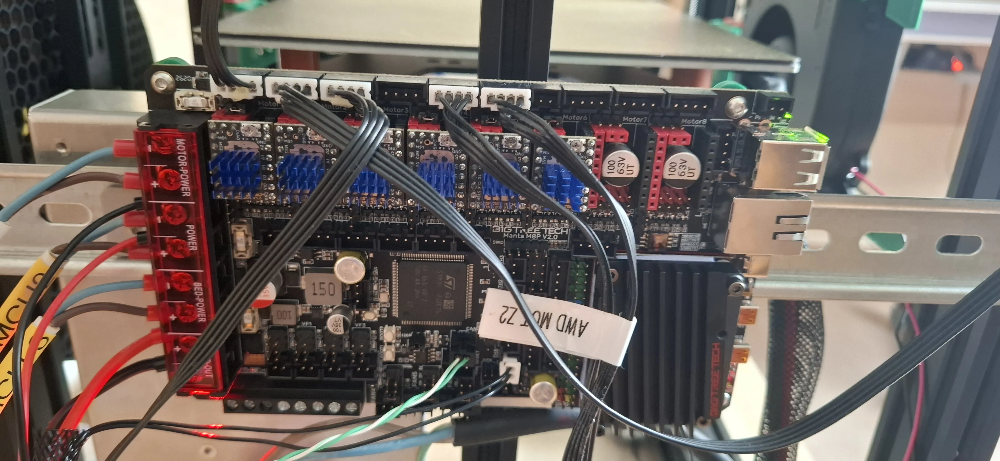
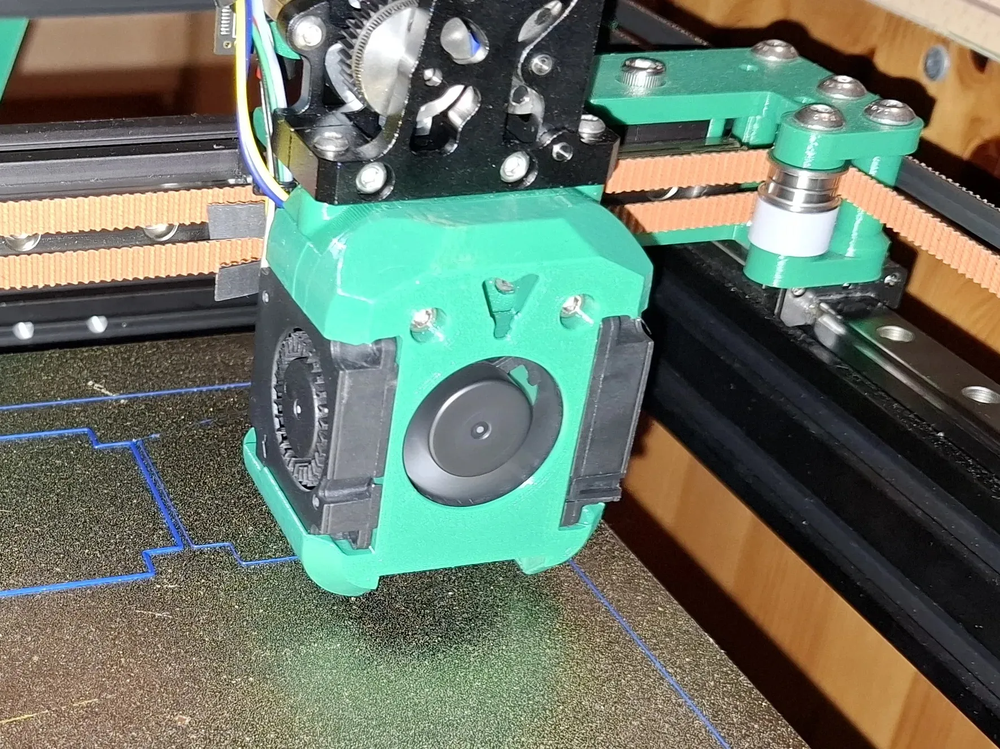

Running two Creality v4.2.2 boards under a Raspberry Pi 4B served its purpose. For cleaner wiring, quiet TMC2209 drivers with *sensorless homing*, and future expansion such as a toolchanger, we moved to a **BIGTREETECH Manta M8P v2.0** at the end of August. It uses a **BTT CB1** compute module and a **BTT EBB36** CANbus board on the DragonBurner toolhead.



## 1. Installing the system on the BTT CB1

When preparing the OS image—Debian with Klipper and Moonraker preinstalled from BTT's GitHub—we encountered an important difference from a conventional Raspberry Pi: **do not use Raspberry Pi Imager's OS Customization settings for Wi-Fi and SSH**. The CB1 ignores them.

Instead:

1. Write the unmodified `.img.xz` image to the microSD card.
2. Open the `BOOT` partition in an editor that preserves Unix line endings, such as VS Code or Notepad++.
3. Uncomment and fill in the values directly in `system.cfg`:

```ini
WIFI_SSID="Vase_Nazev_WiFi"
WIFI_PASSWD="Vase_Heslo_Na_WiFi"
hostname="TweetONE-M"
```

## 2. Bringing up the BTT EBB36 CANbus board with CanBoot

To avoid running a bundle of ten wires to the toolhead, we fitted a BTT EBB36 board to the DragonBurner. We brought it up over USB from the CB1:

1. Hold the BOOT button on the EBB36 while connecting the USB cable. The board enters DFU mode, which can be confirmed with `lsusb`.
2. Clone the Arksine/CanBoot repository, configure it with `make menuconfig`, and flash the bootloader.
3. Compile and flash the Klipper firmware for the EBB36.



## 3. Motor mapping and sensorless homing on the Manta M8P v2.0

The Manta M8P v2.0 has eight driver slots, allowing us to connect all six active motors and keep two slots in reserve:

* Motor 1: Left XY motor (`stepper_x`, `diag_pin: ^PF4`)
* Motor 2: Right XY motor (`stepper_y`, `diag_pin: ^PF3`)
* Motor 3: Extruder
* Motor 6: Front-left Z motor (`stepper_z`)
* Motor 7: Rear Z motor (`stepper_z1`)
* Motor 8: Front-right Z motor (`stepper_z2`)

We enabled sensorless homing for X and Y using the TMC2209 drivers instead of mechanical endstops. In Klipper, this requires `homing_retract_dist: 0` and careful tuning of `driver_SGTHRS`. We started at 100 and adjusted the sensitivity so the head stopped reliably without striking the frame.

```
[stepper_x]
step_pin: PE6
dir_pin: PE5
enable_pin: !PC14
microsteps: 16
rotation_distance: 40
endstop_pin: tmc2209_stepper_x:virtual_endstop
position_endstop: 0
position_max: 235
homing_speed: 40
homing_retract_dist: 0

[tmc2209 stepper_x]
uart_pin: PC13
diag_pin: ^PF4
run_current: 0.800
driver_SGTHRS: 100
```

## Small problems and how we addressed them

**Carriage collision:** While testing the full range of motion, the carriage caught on a plastic frame bracket. We shortened the part by a few millimeters in CAD and printed it again.

**Fan switching through a MOSFET:** For reliable cooling control on FAN0, we added an external switching module with an IRF520 transistor.

---

[← Previous](/blog/tweetone-chapter3/ "3. First print, 0.005 mm Z-Tilt accuracy, and the move to DragonBurner") · [Overview](/blog/tweetone-corexy-build-notes/ "TweetONE CoreXY: from two Ender 3s to a high-speed CoreXY build") · [1](/blog/tweetone-chapter1/ "1. Building a CoreXY printer from two second-hand Ender 3s") · [2](/blog/tweetone-chapter2/ "2. Building the frame, choosing a design, and bringing two Creality boards up in Klipper") · [3](/blog/tweetone-chapter3/ "3. First print, 0.005 mm Z-Tilt accuracy, and the move to DragonBurner") · **[4]** · [5](/blog/tweetone-chapter5/ "5. Input Shaper tuning (14,400 mm/s²) and BTT Eddy Duo thermal drift") · [6](/blog/tweetone-chapter6/ "6. A future graduation project: measuring anti-backlash nuts and belt tension") · [Next →](/blog/tweetone-chapter5/ "5. Input Shaper tuning (14,400 mm/s²) and BTT Eddy Duo thermal drift")
