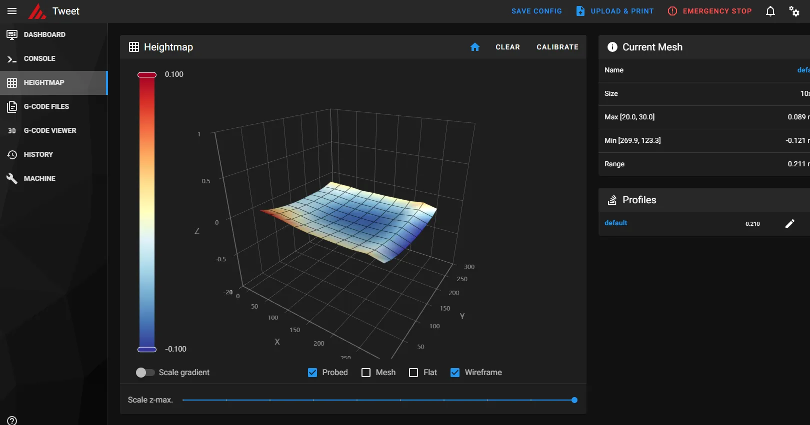

With the Manta M8P v2.0 and DragonBurner running, we reached a crucial stage: tuning the high-speed CoreXY motion system with **Input Shaper** and calibrating the **BTT Eddy Duo** probe for temperature drift. The goal was a consistent first layer when printing PLA and when heating the bed to 100 °C for ABS/ASA.

[https://youtu.be/TXev-ikeR5w](https://youtu.be/TXev-ikeR5w)

## Measuring resonances: Input Shaper (`SHAPER_CALIBRATE`)

Using the accelerometer integrated into the BTT EBB36 CANbus board, we measured the natural resonant frequencies of the TweetONE frame on both axes:

| Axis | Recommended shaper | Resonant frequency | Remaining vibrations | Recommended max. acceleration |
| :--- | :---: | :---: | :---: | :---: |
| **Axis&nbsp;X** | **mzv** | **69.8&nbsp;Hz** | **0.8&nbsp;%** | **≤&nbsp;14,400&nbsp;mm/s²** |
| **Axis&nbsp;Y** | **mzv** | **53.8&nbsp;Hz** | **0.7&nbsp;%** | **≤&nbsp;8,500&nbsp;mm/s²** |

The **14,400 mm/s²** recommendation on X, with just 0.8% remaining vibrations, confirmed the rigidity of the aluminum frame, metal corner brackets, and Japanese THK SRS 12GN linear rail.

## Addressing thermal drift in the BTT Eddy Duo

Eddy current probes can scan an entire bed in seconds, but their measurements are sensitive to temperature. As the heated bed warms up, the measured Z-offset changes.

To avoid errors such as `Must home axis first` and `Invalid probe_eddy_current height`, which we resolved through the correct `descend_z: 2.5` setting and `X=0, Y=32, Z=3.5` coordinates, we performed a full **probe thermal calibration**:

1. **Basic probe current calibration:** We used `PROBE_EDDY_CURRENT_CALIBRATE CHIP=btt_eddy`, optionally with a temporary `SET_KINEMATIC_POSITION Z=50` during initial setup, and the usual paper test.
2. **Starting the temperature curve:** We extended the idle timeout and started the automatic calibration cycle in 4 °C steps:
   ```gcode
   SET_IDLE_TIMEOUT TIMEOUT=36000
   TEMPERATURE_PROBE_CALIBRATE PROBE=btt_eddy TARGET=56 STEP=4
    ```
Heating the printer: We set the bed to 100 °C and the extruder to 240 °C so the BTT Eddy Duo sensor itself would gradually warm up.

Repeated measurement: Each time the probe temperature rose by 4 °C, Klipper automatically parked the head and prompted us to verify nozzle height with a paper test.

Saving the curve: Once the target temperature was reached, we completed calibration with TEMPERATURE_PROBE_COMPLETE and saved it to printer.cfg using SAVE_CONFIG.

From then on, different print temperatures no longer affected the probe in the same way: BED_MESH_CALIBRATE ADAPTIVE=1 maps only the area of the upcoming print before each job.



---

[← Previous](/blog/tweetone-chapter4/ "4. Switching to the BTT Manta M8P v2.0, CB1, and EBB36 CANbus toolboard") · [Overview](/blog/tweetone-corexy-build-notes/ "TweetONE CoreXY: from two Ender 3s to a high-speed CoreXY build") · [1](/blog/tweetone-chapter1/ "1. Building a CoreXY printer from two second-hand Ender 3s") · [2](/blog/tweetone-chapter2/ "2. Building the frame, choosing a design, and bringing two Creality boards up in Klipper") · [3](/blog/tweetone-chapter3/ "3. First print, 0.005 mm Z-Tilt accuracy, and the move to DragonBurner") · [4](/blog/tweetone-chapter4/ "4. Switching to the BTT Manta M8P v2.0, CB1, and EBB36 CANbus toolboard") · **[5]** · [6](/blog/tweetone-chapter6/ "6. A future graduation project: measuring anti-backlash nuts and belt tension") · [Next →](/blog/tweetone-chapter6/ "6. A future graduation project: measuring anti-backlash nuts and belt tension")
