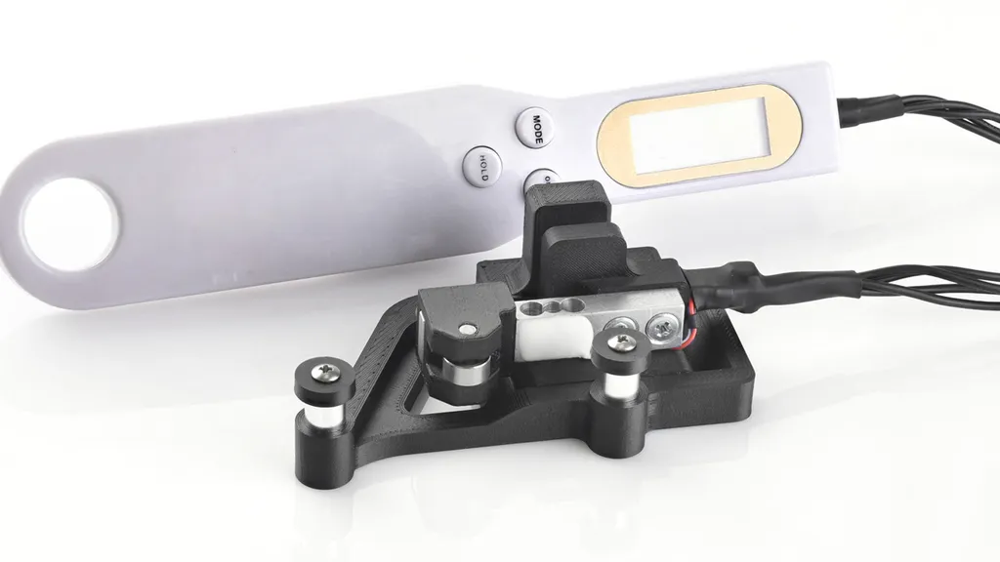

From the beginning, **TweetONE** was intended to be more than a weekend project. Our son is due to graduate in two years, and the printer will form the practical basis of his **graduation project**, combining mechanics, electronics, and measurements of motion-system accuracy.

Beyond building and commissioning the printer, which is based on the community [Duender CoreXY](https://www.printables.com/model/1282344-duender-mgn12h-edition) conversion, our development notes identified two areas that matter for print quality on CoreXY machines built from older components. These will be the focus of his project.

## 1. How anti-backlash POM nuts affect Z-axis accuracy

On affordable printers such as the Ender 3, lead screws are often slightly bent, and conventional brass nuts have a small amount of play between their threads (*backlash*). Direction changes and tiny corrections during `Z_TILT_ADJUST` and `BED_MESH` can introduce positioning errors and visible wall ripples (*Z-wobble*).

For his future project, our son plans to compare conventional brass nuts with two-piece, spring-loaded **POM (Delrin) anti-backlash nuts**, drawing on an [analysis of Z-axis anti-backlash nut accuracy](https://www.youtube.com/watch?v=kmqLz-AmzVw) and an installation on the [Ender 3 series](https://www.youtube.com/watch?v=Lpc1bTsSpRA):

* **Taking up backlash:** The spring continuously pushes the two nut halves against opposite sides of the thread, eliminating axial play.
* **Damping vibration and quieter operation:** POM is an engineering plastic with low friction and high wear resistance. Together with flexible motor couplings, it allows a slightly bent screw to "float" without transferring its runout to the bed's linear rails, similar to the [Ender 3 NG approach to reducing Z-wobble](https://www.youtube.com/watch?v=1dhn0S28OuU).
* **Planned measurement method:** By repeatedly moving the Z axis to a target position and evaluating repeatability with a probe and dial indicator, we plan to quantify the difference in positioning accuracy between the two nut types and assess the effect on printed surfaces.

## 2. DIY GT2 belt tension meter with a strain gauge

In [CoreXY](https://3ddistributed.com/corexy-3d-printer/corexy-belt-routing/) kinematics, **both belts (A and B) need equal tension**. If one is tighter than the other, the X gantry can skew slightly, printed corners can lose squareness, and resonance behavior can deteriorate at higher accelerations.

Rather than judging tension by the sound of a plucked belt or buying an expensive commercial gauge, we plan to build our own **GT2 (6 mm)** belt tension meter with a strain gauge, following the [GT2 Belt Tension Meter with strain gauge sensor](https://www.youtube.com/watch?v=vsF08ZM7MTI) guide:

### Planned parts list for the tension meter

* **Sensor and electronics:** A strain gauge and display salvaged from a [digital kitchen spoon scale](https://www.aliexpress.com/item/1005011682429430.html), with a 500 g range and 0.1 g resolution.
* **Meter body:** 3D-printed parts for the body, lever, and holder.
* **Mechanical parts:**
  * 1× ball bearing `3 × 8 × 4 mm`
  * 1× pin `13,5 × 3 mm` and 1× shaft `2 × 43 mm`
  * 1× compression spring (`0,5 mm` wire diameter, `5 mm` outside diameter, `27 mm` length)
  * 2× metal inserts `5,1 × 6,8 × 10,5 mm`
  * Screws: 2× countersunk `M3 × 5,5 mm` and 2× countersunk `M3 × 10 mm`

The meter should let us set both CoreXY belt branches to the same numerical reading. Our son then plans to document how controlled changes in belt pretension affect **Input Shaper** resonance curves and the dimensional accuracy of finished prints.

## Sources and references from the development log

* [Will this Z axis anti backlash nut improve your 3D printer accuracy? (YouTube)](https://www.youtube.com/watch?v=kmqLz-AmzVw)
* [Stop the Drop! Install an Anti-Backlash Nut on Ender-3 Series (YouTube)](https://www.youtube.com/watch?v=Lpc1bTsSpRA)
* [GT2 Belt Tension Meter with strain gauge sensor (YouTube)](https://www.youtube.com/watch?v=vsF08ZM7MTI)
* [CoreXY Belt Routing – principles and belt tensioning (3D Distributed)](https://3ddistributed.com/corexy-3d-printer/corexy-belt-routing/)

---

[← Previous](/blog/tweetone-chapter5/ "5. Input Shaper tuning (14,400 mm/s²) and BTT Eddy Duo thermal drift") · [Overview](/blog/tweetone-corexy-build-notes/ "TweetONE CoreXY: from two Ender 3s to a high-speed CoreXY build") · [1](/blog/tweetone-chapter1/ "1. Building a CoreXY printer from two second-hand Ender 3s") · [2](/blog/tweetone-chapter2/ "2. Building the frame, choosing a design, and bringing two Creality boards up in Klipper") · [3](/blog/tweetone-chapter3/ "3. First print, 0.005 mm Z-Tilt accuracy, and the move to DragonBurner") · [4](/blog/tweetone-chapter4/ "4. Switching to the BTT Manta M8P v2.0, CB1, and EBB36 CANbus toolboard") · [5](/blog/tweetone-chapter5/ "5. Input Shaper tuning (14,400 mm/s²) and BTT Eddy Duo thermal drift") · **[6]**
