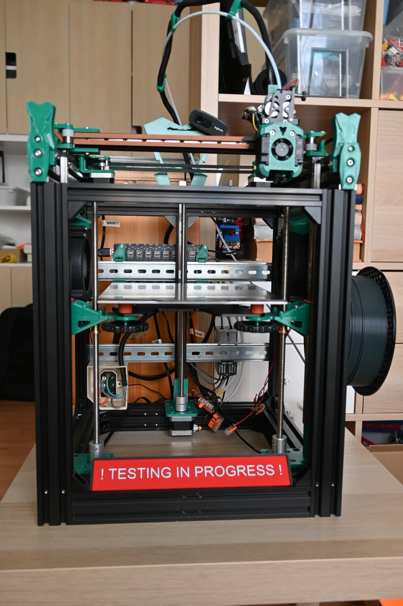

### Fáze 1 — Návrh v Onshape a výběr kolejnic

**Prosinec 2025.** Zaměřili jsme dostupné profily z obou tiskáren Ender 3 a začali navrhovat geometrii CoreXY s kolejnicemi THK SRS a kompaktnějším portálem.

### Fáze 2 — Spuštění Klipperu se dvěma MCU

**Leden 2026.** Raspberry Pi 4B úspěšně řídilo dvě desky Creality v4.2.2 současně a ověřilo koncepci více MCU ještě před obráběním a montáží.

### Fáze 3 — Origami, nebo průmyslová konstrukce

**Únor až červen 2026.** Zkoumali jsme koncepci Origami i průmyslovou konstrukci a následně navrhli vlastní napínáky řemenů a zpřesnili mechaniku.

### Fáze 4 — Z-Tilt a první úspěšný výtisk

**Červenec až srpen 2026.** Osa Z byla kalibrována s naměřenou odchylkou roviny 0,005 mm. Tiskárna zvládla první úspěšnou první vrstvu i celý výtisk.

### Fáze 5 — BTT Manta M8P v2.0 + EBB36 CANbus + DragonBurner

**Srpen až září 2026.** Řadič pohybu jsme upgradovali na BTT Manta M8P v2.0 s CB1 [[6]](#ref-6) [[7]](#ref-7) a následně na CANbus nástrojovou desku BTT EBB36 [[8]](#ref-8) s DragonBurnerem [[9]](#ref-9). Měření Input Shaperu nastavené v Klipperu [[5]](#ref-5) potvrdilo výsledné nastavení: osa Y 53,8 Hz a osa X 69,8 Hz, s bezpečným zrychlením přibližně 8 500 mm/s² a 14 400 mm/s².

